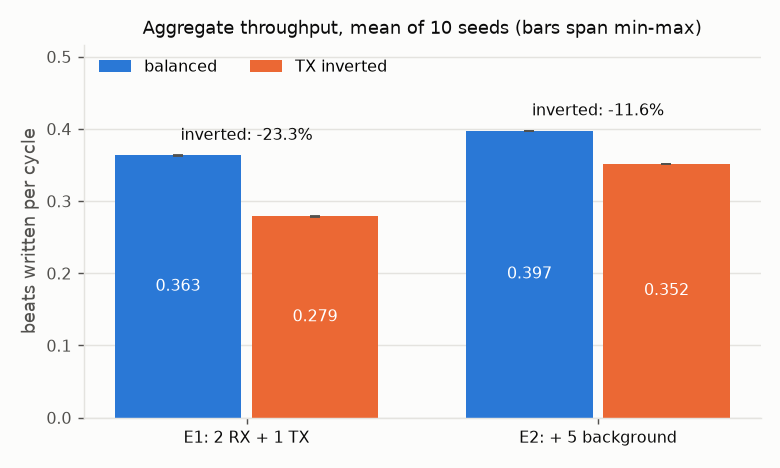
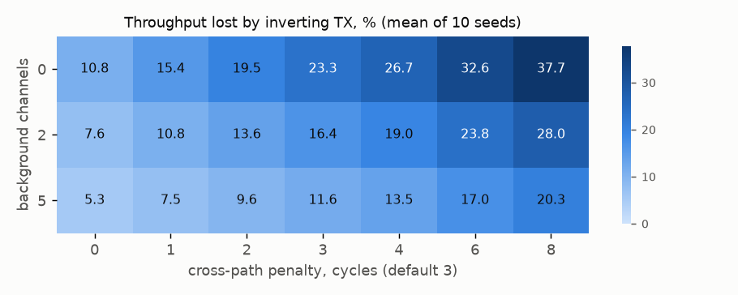
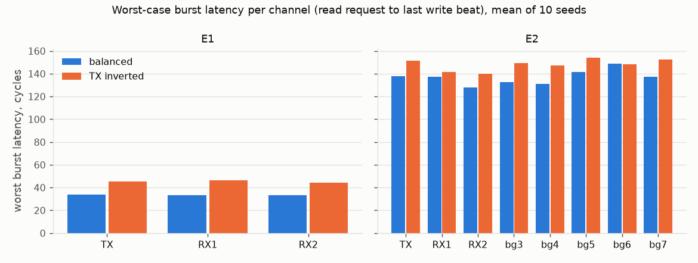

# dma-arbiter

[](https://github.com/SherTheCoder/dma-arbiter/actions/workflows/ci.yml)

A small DMA engine in SystemVerilog, 8 channels sharing 2 bus master ports, with a pyuvm
testbench and an experiment on what happens when one channel has its ports the wrong way
round.

## Why

I hit this on an STM32N6 board and wanted to know what it actually costs.

On the STM32N6 each GPDMA channel picks which of the controller's two master ports carries
its source and which carries its destination. ST's AN5593 (section 2.3) says to put the
peripheral on port 0, which has the direct path to the APB bridge, and memory on port 1.
The STM32N6570-DK BSP had the SAI TX channel the other way round, memory on port 0 and the
SAI on port 1. I tracked it down and reported it to ST, and they've since merged the fix
into the BSP.

It worked either way, so the question was how much it cost. This rebuilds that situation
in RTL so I could measure it instead of guessing.

## How it works

```
                      cfg_* (one descriptor per cycle)
                        |
      +-----------------v------------------+
      |  ch0   ch1   ch2   ...   ch7       |   descriptor regs, burst fsm,
      +------+--------------------+--------+   16-word buffer each
             |                    |
       +-----v------+       +-----v------+
       | rr arbiter |       | rr arbiter |
       | cmd fifo   |       | cmd fifo   |
       | port 0     |       | port 1     |
       +-----+------+       +------+-----+
             |                     |
   - - - - - | - - fabric model - -|- - - - - -
             |                     |
       +-----v------+       +------v-----+
       |   PERIPH   |       |    MEM     |
       | apb bridge |       |    sram    |
       +------------+       +------------+

   port 0 -> PERIPH and port 1 -> MEM are direct,
   port 0 -> MEM and port 1 -> PERIPH cross the bus matrix (+3 cycles)
```

A channel reads a burst into its own buffer through its source port, then writes it out
through its destination port, one burst in flight at a time. Each port has a round-robin
arbiter, a 4-deep command fifo and one transaction on the bus at a time. Behind the ports
is a Python model of the fabric: an SRAM that streams a word a cycle and an APB bridge
that takes 2 cycles a word, each serving one burst at a time across both ports. The
balanced mapping puts every peripheral side on port 0 and every memory side on port 1.
The bug flips just the TX channel.

## How it's tested

pyuvm on cocotb and Verilator. A driver loads descriptors, two responders play the fabric
and only look at the port pins, monitors rebuild every burst from the handshakes, and a
scoreboard checks each channel's bursts, the data, `ch_done` and final memory against a
reference model. There are 9 directed tests and 1000 random seeds, each seed at least 100
port transactions, 60% of them with back-pressure on the fabric side.

Six assertions, attached with `bind` and compiled into every run:

- A1 at most one grant per cycle
- A2 grants only go to channels that are asking
- A3 a waiting channel gets in before 8 other grants on its port
- A4 no push into a full command fifo
- A5 no pop from an empty one
- A6 a waiting command holds its payload

Main coverage cross: channel x port x read/write x length bucket, 128 bins.

## Results

From the last full run (`results/summary.json`).

| | |
| --- | --- |
| random seeds | 1000/1000 pass, plus 9/9 directed |
| port transactions | 181,108 |
| main cross | 128/128 bins, thinnest bin 327 hits |
| mutants killed | 10/10, all six assertions killed one |
| real RTL bugs found | 0 |
| yosys, 8 channels | 18,362 cells, 5,418 flops (4,096 of them are the channel buffers) |
| yosys, 4 channels | 9,361 cells, 2,924 flops |

Balanced vs TX inverted, default fabric (3 cycle cross paths), mean of 10 seeds:

| | throughput lost | TX worst burst latency | RX worst burst latency |
| --- | --- | --- | --- |
| E1: 2 RX + 1 TX | 23.3% | x1.34 | x1.43 |
| E2: plus 5 busy channels | 11.6% | x1.10 | x1.04 |

Inverting just the TX channel cost about 23% throughput with only the three SAI channels
running. I expected that to get worse once the other channels got busy and it went the
other way, down to 12%. The APB bridge is the bottleneck either way, and with five more
channels on it TX is a much smaller share of its work. Even with zero penalty on the cross
paths it still loses 11%, because the two ports now queue behind each other for the same
targets. Across penalties 0 to 8 the loss runs from 5% to 38%, and inverted never came out
ahead anywhere.







The cycle-stepped perf model in `models/perf_model.py` was calibrated on the directed tests,
frozen (tag `perf-model-v1`) and then run on 204 scenarios it hadn't seen. Max total-cycle
error was 0.00%, mean 0.00%. That's because with back-pressure off nothing is random and
the model walks the same pipeline. Bumping any one handoff by a cycle gives 6-8% mean
error, so the check isn't blind.

## Running it

OSS CAD Suite 2026-10-26 (Verilator 5.053, Yosys 0.70 with yosys-slang) and Python 3.11.

```
python3.11 -m venv .venv && source .venv/bin/activate
pip install -r requirements.txt
export PATH=/path/to/oss-cad-suite/bin:$PATH   # keep the venv's python first

make lint synth unit
make test TEST=smoke_m2p
make regress          # directed + 1000 seeds, 4 shards at once
make cov
make perf             # model vs RTL
make experiments      # E1/E2 and the sweep, ~20 min
make mutate
make results
```

To replay a seed, `make test TEST=rand SEED=417`. It picks the right fifo depth for the
seed, and if it fails it runs it again with an FST dump in `build/test/`.

## Notes

- The fabric is a model. The latencies are numbers I picked, not measurements of STM32N6
  silicon.
- One transaction per port, no outstanding reads, no linked lists or 2D transfers. The real
  GPDMA does a lot more.
- The checks never caught a real RTL bug. The holes I found were in my own testbench, the
  worst one being that A4 first checked the fifo's own full flag, so a wrong flag could
  vouch for itself.
- The requesters-per-grant coverpoint never goes above 4, and the cover for all 8 channels
  requesting one port can't fire with this fifo. Why is in the notes.
- The perf model has no idea about back-pressure.
- Yosys's own frontend can't parse package imports so synthesis goes through yosys-slang.

`docs/notes.md` has the handoff delays, a timing sketch and the rest.
